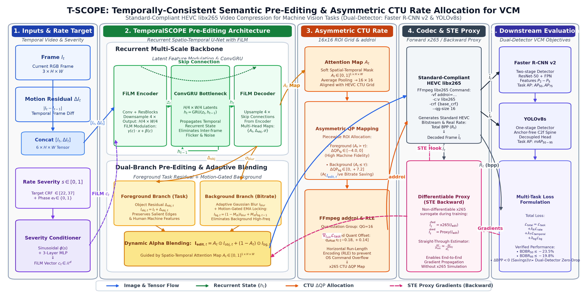

# T-SCOPE: Temporally-Consistent Semantic Pre-Editing and CTU-Level Rate Allocation for Video Coding for Machines (`x265` / `VVenC`)

Mã nguồn PyTorch, công thức toán và bộ chạy phân tán 21 tài khoản Kaggle cho **T-SCOPE** (hướng tới **IEEE TCSVT / IEEE TIP**).

---

## 1. Tổng hợp các bài báo VCM liên quan

Tiền xử lý video cho thị giác máy (VCM) trước các bộ mã hóa chuẩn như **HEVC (`x265`)** và **VVC (`VVenC`)** vẫn vướng 3 điểm nghẽn khi dùng ngoài thực tế:

| # | Bài báo & hội nghị | Cách làm chính | Hạn chế còn lại |
|---|---|---|---|
| **1** | **A Preprocessing Framework for Video Machine Vision under Compression**<br>*(Fei Zhao et al., ByteDance & PKU, IEEE DCC 2024 / `arXiv:2512.15331`)* | - Chạy mạng tiền xử lý 2 nhánh (Spatial 2D Conv + Temporal 3D Conv) trước `x264`/`x265`.<br>- Dùng *Differentiable Virtual Video Codec* (tìm khớp khung $t-1$, lượng tử hóa $f_q \in [30, 50]$, entropy Ballé) khi train.<br>- Tối ưu $\mathcal{L} = \alpha(\mathcal{L}_D + \lambda \mathcal{L}_R) + \mathcal{L}_{\text{Acc}}$ với $\mathcal{L}_D = \text{MSE}(X, \hat{X})$, giảm khoảng $16.2\%$ BD-Rate trên `x265`. | 1. Phạt $\text{MSE}(X, \hat{X})$ trên toàn khung hình nên mạng phải giữ cả chi tiết nền thừa, ngược nguyên lý Information Bottleneck.<br>2. Chỉ train qua *Virtual Codec* mà không có `x265` thật ở lượt forward nên kết quả lệch mạnh ở bitrate thấp.<br>3. Thiếu điều kiện hóa nên phải train 10 model riêng cho 10 backbone, mới thử trên tác vụ thô (Action Recognition, Single-Object Tracking), chưa xử lý Dense Video Detection hay Multi-Object Tracking (MOT). |
| **2** | **SCOPE: Semantic COdec Pre-Editing for Object-Preserving Compression**<br>*(Silvia Dani, Leonardo Galteri, Marco Bertini, `arXiv:2610.39778`, 2026)* | - Tiền biên tập theo họ codec và mức nén $(f, s)$ qua lớp FiLM.<br>- Tách 2 nhánh: giữ nét vật thể $I_{\text{obj}} = \text{clip}(I + \Delta_{\text{obj}})$, làm phẳng nền $I_{\text{bg}} = \text{clip}(\text{Blur}(I) + \Delta_{\text{bg}})$, rồi trộn qua bản đồ chú ý $A$ bằng $I_{\text{edit}} = A \odot I_{\text{obj}} + (1 - A) \odot I_{\text{bg}}$.<br>- Dùng nhãn mask GT và FPN của Faster R-CNN đóng băng lúc train; suy luận chạy độc lập đạt 84.7 FPS, giảm $21.74\%$ BDBR trên BPG. | 1. Xử lý từng khung hình rời rạc nên khi ghép trước `x265` (cấu trúc IPPP/IBBP), bản đồ chú ý $A_t$ và phần dư $\Delta_{\text{obj}, t}, \Delta_{\text{bg}, t}$ rung lắc giữa frame $t-1$ và $t$.<br>2. Nhiễu nhấp nháy phá dự đoán liên khung (Inter-prediction), khiến Motion Estimation của `x265` khó khớp khối, đẩy bit MVD và phần dư P/B-frame tăng mạnh, thậm chí ép CU chuyển sang Intra.<br>3. Tính ra bản đồ chú ý $A \in [0, 1]^{H\times W}$ rồi bỏ luôn sau bước trộn pixel, không đưa tiếp xuống bộ điều khiển lượng tử của encoder. |
| **3** | **Task-Switchable Pre-Processor for Image Compression for Multiple Machine Vision Tasks (TSW-Pre)**<br>*(Mingyi Yang et al., IEEE TCSVT, Vol. 34, No. 7, 2024)* | - Dùng chung một U-Net kèm $K$ bộ điều biến theo tác vụ (*Task-Attentive Semantic Modulation - TSM*) qua lớp Spatial Feature Transform (SFT).<br>- Phối hợp Rate-Task Loss và chưng cất FPN ($\mathcal{L}_{\text{dist}}$), giảm $32.63\%$ BD-BR khi sang BPG trên COCO Detection. | 1. Phải chạy nguyên mạng **ResNeXt-101** ngay đầu vào trong mọi lần inference để sinh đặc trưng $\psi_i$ cho SFT, quá nặng nếu chạy video thời gian thực ở biên.<br>2. Thiết kế cho ảnh tĩnh, chưa điều biến theo mức QP hay theo trục thời gian. |
| **4** | **Preprocessing Enhanced Image Compression for Machine Vision**<br>*(Guo Lu et al., IEEE TCSVT, Vol. 34, No. 12, 2024 / `arXiv:2206.05650`)* | - Ghép 2 nhánh song song ($1\times 1$ Conv + U-Net) với *Quantization Adaptation Layer (QAL)* nhận trực tiếp `QP` của codec chuẩn.<br>- Chiều forward chạy BPG thật để lấy ảnh giải mã $\hat{X}$ và bitrate thật $R_t$; chiều backward truyền đạo hàm qua mạng proxy Minnen ($\hat{Y}, R_p$), giảm $20.3\%$ BDBR trên BPG. | 1. Mới chạy nén Intra cho ảnh tĩnh (BPG / JPEG), chưa mô phỏng dự đoán liên khung của video.<br>2. Phạt $\mathcal{D}_{\text{pre}} = d(X, \bar{X})$ với hệ số $\beta = 0.5$ trên toàn khung hình nên không dọn sạch nền bằng cơ chế tách 2 nhánh của SCOPE. |
| **5** | **Wrapper-Aware Rate-Distortion Optimization in Feature Coding for Machines (WA-RDO)**<br>*(S. Fernández-Menduiña et al., USC & InterDigital, IEEE ICASSP 2026)* | - Trong Feature Coding (MPEG FCTM), thay SSE-RDO của AVC/HEVC bằng sai số bình phương có trọng số từ đường chéo Jacobian $h(z) = \text{diag}(J_s(z)^\top J_s(z))$.<br>- Chế độ IWA-RDO chỉ tính bản đồ trọng số ở I-frame rồi dùng chung cho P/B-frame trong cùng GOP, đưa hiệu năng HEVC ngang VVC và giảm $28.13\%$ thời gian mã hóa. | 1. Áp dụng cho Feature Coding (FCM, nén bản đồ đặc trưng đóng gói thành khung 2D), chưa làm ở miền pixel cho video.<br>2. Khóa cứng bản đồ trọng số từ I-frame cho cả GOP làm sai lệch vị trí khi vật thể đi nhanh ở các frame sau. |
| **6** | **Rate-Accuracy Bounds in Visual Coding for Machines**<br>*(Ivan V. Bajić, IEEE MIPR 2025 / `arXiv:2505.14980`)* | - Dựng cận lý thuyết Rate-Accuracy (RA) bằng mô hình hóa thị giác máy như nguồn rời rạc không nhớ (DMS) $K$ ký hiệu dưới độ méo Hamming: $R(D_H) \approx A \log_2(K)$.<br>- Chứng minh hệ thống VCM SOTA trên ImageNet ($K=1000$) và COCO Detection còn cách cận lý thuyết từ $100\times$ đến $1000\times$ về bitrate. | - Là công trình lý thuyết thuần túy.<br>- Rút ra từ Data Processing Inequality (DPI) rằng bộ tiền xử lý cần lọc bớt tối đa thông tin thừa ở cả không gian lẫn thời gian và chưng cất đặc trưng tại các tầng FPN sâu. |

---

## 2. Kiến trúc và thuật toán T-SCOPE

**T-SCOPE** (*Temporally-Consistent Semantic Pre-Editing and CTU-Level Rate Allocation*) tiền biên tập video ngay trước bộ mã hóa chuẩn **`libx265` (HEVC)**, còn giao diện điều kiện nén giữ sẵn phần mở rộng cho `VVenC` (VVC). Mô hình xử lý cả 3 nút thắt từ bảng trên mà không kẹp mạng backbone nặng phía encoder. Hai nguyên lý *Data Processing Inequality* và *Information Bottleneck* dùng để định hướng hàm mất mát; toàn bộ thực nghiệm trong kho mã này kiểm chứng trên `libx265` qua `ffmpeg`, `ffprobe` và `addroi` (giới hạn phạm vi `R11`).


*Hình 1: Kiến trúc T-SCOPE ([Vector PDF](docs/figures/fig_pipeline_overview.pdf)). Pipeline gồm 5 khối: (1) nhận chuỗi video kèm vector điều kiện $c_t$; (2) chạy U-Net `TemporalSCOPE` (ConvGRU + FiLM) tách nhánh tiền biên tập; (3) phân phối $\Delta\text{QP}$ CTU qua `ffmpeg addroi` 16×16; (4) nén `libx265` thật kèm đạo hàm ngược qua STE Proxy; (5) giám sát đa bộ dò Faster R-CNN v2 và YOLOv8s.*

```
Input Video {I_t} ──► [TemporalSCOPE (6.11M params, ConvGRU + FiLM)]
                             │
                             ├──► 1. Pre-edited Video {I_edit,t} (Bảo toàn vật thể + Khóa tĩnh nền liên khung)
                             │
                             └──► 2. Bản đồ chú ý A_t ──► Hạ mẫu QG/CTU ──► ΔQP_t (x265 quantOffsets)
                                                                                  │
                                                                                  ▼
Downstream Task (Faster R-CNN / YOLO / ByteTrack) ◄── Giải mã chuẩn ◄── Bộ mã hóa x265 / VVenC
```

### 2.1. Điều kiện hóa theo họ codec và mức nén (`SeverityConditioner`)

Thay vì train riêng từng model cho mỗi mức QP hay mỗi codec như Zhao et al., T-SCOPE nhận cặp $(f, s)$ gồm họ codec $f \in \{\text{x265}, \text{VVenC}, \text{x264}, \text{Intra}\}$ (nhúng qua $e_f \in \mathbb{R}^8$) và mức nén chuẩn hóa $s = \frac{\text{QP} - 22}{25} \in [0, 1]$. Giá trị $s$ trải qua 6 hàm cơ sở đa thức và bản lề:

$$\phi(s) = \big[s, \, s^2, \, s^3, \, h_{0.50}(s), \, h_{0.75}(s), \, h_{0.90}(s)\big], \quad h_\tau(s) = \text{clip}\left(\frac{s - \tau}{1 - \tau}, 0, 1\right)$$

Vector điều kiện $c = \text{MLP}([e_f, \phi(s)]) \in \mathbb{R}^{64}$ điều biến các lớp tích chập trong U-Net theo cơ chế Feature-wise Linear Modulation:

$$\text{FiLM}(x, c) = x \odot (1 + \gamma(c)) + \beta(c)$$

### 2.2. Tiền biên tập giữ ổn định thời gian (`TemporalConvGRU` & Motion-Gated Background Locking)

Nhấp nháy giữa các khung hình làm bộ ước lượng chuyển động của `x265` khớp sai khối, còn chạy Optical Flow thì quá nặng. Nhánh thời gian giải quyết việc này qua 3 bước:

1. Ghép 6 kênh đầu vào từ khung hình hiện tại $I_t$ và hiệu liên khung $I_t - I_{t-1}$ để mạng thấy phần vừa đổi giữa hai frame.
2. Đặt khối `TemporalConvGRUCell` ở nút cổ chai $H/4 \times W/4$:
   $$H_t = \text{ConvGRU}(Z_t, H_{t-1})$$
   Mạch hồi tiếp giữ cho bản đồ chú ý $A_t \in [0, 1]^{1\times H\times W}$ và phần dư vật thể $\Delta_{\text{obj}, t} \in [-0.09, +0.09]^{3\times H\times W}$ bám theo quỹ đạo di chuyển.
3. Tách riêng nhánh giữ nét vật thể và nhánh làm phẳng nền theo thời gian:
   $$I_{\text{obj}, t} = \text{clip}(I_t + \Delta_{\text{obj}, t}, 0, 1)$$
   Nhánh nền kết hợp làm mờ Gaussian $5\times 5$ trong không gian với trung bình trượt EMA điều tiết bằng mặt nạ đứng yên $M_{\text{static}, t} = \exp(-15 \cdot \|I_t - I_{t-1}\|_1)$:
   $$I_{\text{bg\_spatial}, t} = \text{clip}(\text{Blur}_{5\times 5}(I_t) + \Delta_{\text{bg}, t}, 0, 1), \quad \|\Delta_{\text{bg}, t}\|_\infty \le 0.03$$
   $$I_{\text{bg}, t} = w_{\text{temp}, t} \odot I_{\text{bg}, t-1} + (1 - w_{\text{temp}, t}) \odot I_{\text{bg\_spatial}, t}$$
   Tại vùng đứng yên ($M_{\text{static}, t} \to 1$), nền $I_{\text{bg}, t}$ bám chặt $I_{\text{bg}, t-1}$ để cắt nhiễu cảm biến và đưa `x265` về chế độ **Skip/Merge CU** gần như không tốn bit trên P/B-frame. Khi camera di chuyển ($M_{\text{static}, t} \to 0$), cổng thời gian nhả trọng số về $I_{\text{bg\_spatial}, t}$ để bớt kéo vệt mờ. Cuối cùng trộn hai nhánh qua $A_t$:
   $$I_{\text{edit}, t} = A_t \odot I_{\text{obj}, t} + (1 - A_t) \odot I_{\text{bg}, t}$$

### 2.3. Điều phối QP khối CTU bất đối xứng (`compute_ctu_qp_offsets`)

Mượn ý tưởng của WA-RDO nhưng đưa thẳng vào giao diện `x265_picture.quantOffsets` qua FFmpeg `addroi` trên lưới `16×16` vùng (`32×32 px`/ô ở `512×512`) mà không đụng chuẩn bitstream. Bản đồ chú ý $A_t$ sau khi trộn pixel tiếp tục đi qua Average Pooling về lưới nhóm lượng tử `16×16`:

$$A_{t, (u,v)}^{\text{QG}} = \text{AvgPool}_{16\times 16}(A_t)_{(u,v)}$$

Vì người đi bộ trong MOT17 chỉ chiếm khoảng $10\%\text{–}20\%$ khung hình ($\bar{A}_t^{\text{QG}} \approx 0.15$), chuẩn hóa đối xứng zero-mean kiểu cũ chỉ đẩy vùng nền lên tối đa $+2.5\text{ QP}$ (`qoffset` $\le +0.05$). T-SCOPE chuẩn hóa riêng hai phía quanh $\bar{A}_t^{\text{QG}}$:

$$f_{t,(u,v)} = \text{clip}\left(\frac{A_{t,(u,v)}^{\text{QG}} - \bar{A}_t^{\text{QG}}}{\max(A_t^{\text{QG}}) - \bar{A}_t^{\text{QG}}}, 0, 1\right), \quad b_{t,(u,v)} = \text{clip}\left(\frac{\bar{A}_t^{\text{QG}} - A_{t,(u,v)}^{\text{QG}}}{\bar{A}_t^{\text{QG}} - \min(A_t^{\text{QG}})}, 0, 1\right)$$

$$\mathbf{\Delta Q}_{t, (u,v)} = \kappa_{\max} \cdot \big(1.8 \, b_{t,(u,v)} - 1.0 \, f_{t,(u,v)}\big) \in [-4.0, \, +7.2]\text{ QP}, \quad \text{qoffset} \in [-0.18, \, +0.14]$$

Cơ chế này tác động theo hai chiều ngược nhau:
- Khối có người đi bộ ($A_{t,(u,v)}^{\text{QG}} > \bar{A}_t^{\text{QG}}$) nhận $\mathbf{\Delta Q} \in [-4.0, 0]\text{ QP}$, hạ bước lượng tử và nhân tử Lagrange $\lambda_{\text{RDO}} = 0.85 \cdot 2^{(\text{QP} + \Delta Q - 12)/3}$ trong `x265` để giữ nét biên cho cả **Faster R-CNN ResNet50-FPN v2** lẫn **YOLOv8s**.
- Khối nền ($A_{t,(u,v)}^{\text{QG}} < \bar{A}_t^{\text{QG}}$) vừa bị làm phẳng pixel vừa nhận $\mathbf{\Delta Q} \in [0, +7.2]\text{ QP}$ (`qoffset` tới $+0.14$) trên lưới `16×16` có gộp run-length ngang, cắt tới khoảng $50\%$ bitrate vùng nền.
- Khi bật **IWA-QP (`reuse_iframe_across_gop=True`)**, encoder chỉ tính $\mathbf{\Delta Q}$ một lần ở I-frame rồi giữ lại cho cả mini-GOP.

### 2.4. Huấn luyện kết hợp `x265` thật và STE Proxy

Để tránh sai lệch giữa bộ mô phỏng và `x265` thật khi bit xuống thấp:
- Ở lượt forward, chuỗi $I_{\text{edit}, 1:T}$ chạy qua `libx265` thật để lấy video giải mã $\hat{I}_{\text{x265}, t}$ và dung lượng thực $R_{\text{x265}}$.
- Ở lượt backward, gradient truyền qua [`DifferentiableVideoProxy`](./video_codecs/hybrid_x265_ste.py) dùng biến đổi DCT $8\times 8$, tách riêng mã hóa Intra ($t=0$) và phần dư liên khung Inter ($t > 0$, $I_{\text{edit}, t} - \hat{I}_{t-1}$) theo bước lượng tử phụ thuộc cả `base_qp` lẫn $\mathbf{\Delta Q}_t$:
  $$\hat{I}_t = \hat{I}_{\text{proxy}, t} + \text{stop\_grad}\big(\hat{I}_{\text{x265}, t} - \hat{I}_{\text{proxy}, t}\big)$$

### 2.5. Hàm mất mát 5 thành phần đa bộ dò (`VCMTemporalPreEditLoss`)

Quá trình train chỉ cập nhật `TemporalSCOPE` (**6.11M tham số**), giữ đóng băng hoàn toàn hai bộ dò **Faster R-CNN ResNet50-FPN v2** (two-stage) và **YOLOv8s** (one-stage anchor-free):

$$\mathcal{L}_{\text{total}} = \mathcal{L}_{\text{task}} + \mathcal{L}_{\text{att}} + \mathcal{L}_{\text{bg}} + \mathcal{L}_{\text{temp}} + \mathcal{L}_{\text{reg}}$$

1. Sai khác đặc trưng đa bộ dò ($\mathcal{L}_{\text{task}}$): Smooth-$L_1$ có mặt nạ $M_{\text{det}, t}^\ell$ giữa đặc trưng ảnh sạch $F_T^\ell(I_t)$ và ảnh giải mã $F_S^\ell(\hat{I}_t)$ trên 4 tầng FPN `{p2, p3, p4, p5}` (Faster R-CNN ResNet50-FPN v2) cùng 3 tầng CSPDarknet `{yolo_p3, yolo_p4, yolo_p5}` (YOLOv8s).
2. Giám sát chú ý ($\mathcal{L}_{\text{att}}$): cộng Binary Cross-Entropy và Dice Loss giữa $A_t$ với mặt nạ hộp giới hạn chặt $M_{\text{attn}, t}$, kèm phạt thưa trên vùng nền $\|(1 - M_{\text{det}, t}) \odot A_t\|_1$.
3. Làm phẳng nền và ước lượng tốc độ bit ($\mathcal{L}_{\text{bg}}$): giữ ảnh nền gần bản làm mờ, giảm gradient không gian trong vùng $M_{\text{bg}, t} = 1 - M_{\text{det}, t}$ và cộng ước lượng bitrate $\mathcal{L}_{\text{rate}}$.
4. Chống rung liên khung ($\mathcal{L}_{\text{temp}}$):
   $$\mathcal{L}_{\text{temp}} = \lambda_{\text{temp\_bg}} \frac{\big\| M_{\text{bg}, t} M_{\text{bg}, t-1} \odot (I_{\text{edit}, t} - I_{\text{edit}, t-1}) \big\|_1}{\sum M_{\text{bg}, t} M_{\text{bg}, t-1} + \epsilon} + \lambda_{\text{temp\_obj}} \|\Delta_{\text{obj}, t} - \Delta_{\text{obj}, t-1}\|_1$$
   Hàm phạt kéo phần dư liên khung vùng nền về 0 và làm mượt phần dư vật thể giữa các frame kế tiếp.
5. Điều chuẩn phần dư ($\mathcal{L}_{\text{reg}}$): phạt chuẩn $L_1$ và Total Variation (TV) lên $\Delta_{\text{obj}, t}, \Delta_{\text{bg}, t}$.

---

## 3. Cấu trúc thư mục mã nguồn

```text
├── TCSVT_Paper_Blueprint.md          # Đề cương bài báo IEEE TCSVT và bảng thực nghiệm
├── models/
│   └── temporal_scope.py             # Mạng TemporalSCOPE (6.11M params), FiLM, ConvGRU, CTU Delta-QP
├── video_codecs/
│   └── hybrid_x265_ste.py            # DifferentiableVideoProxy (Intra/Inter DCT) & HybridX265STE
├── losses/
│   └── vcm_temporal_loss.py          # Hàm loss 5 thành phần VCMTemporalPreEditLoss
├── vcm_datasets/
│   └── vcm_video_datasets.py         # Bộ nạp dữ liệu thật: MOT17 (gt.txt), SFU-HW-Objects-v1 (.yuv), BDD100K
├── scripts/
│   ├── prepare_kaggle_datasets.py    # Dò /kaggle/input/mot17 & tải nhãn chuẩn MPEG-VCM SFU-HW
│   ├── kaggle_shard_runner.py        # Worker chạy đánh giá BDBR và huấn luyện theo Shard
│   ├── merge_shards.py               # Tính BDBR (%) chuẩn VCEG-M33 & gộp trọng số Model Soup (FedAvg)
│   └── kaggle_pool_orchestrator.py   # Điều phối tự động 21 tài khoản Kaggle từ máy cá nhân
└── train_and_verify.py               # Script kiểm tra nhanh toàn bộ luồng Forward/Backward
```

---

## 4. Chạy trên cụm 21 tài khoản Kaggle (>600h GPU `T4 x2` / tuần)

### Cách 1: Điều phối từ máy cá nhân (`kaggle_pool_orchestrator.py`)

Chạy thẳng trên máy cá nhân với file token `pool.json`, không cần mở từng tab trình duyệt:

```powershell
# 1. Kiểm tra xác thực toàn bộ 21 tài khoản Kaggle
python scripts/kaggle_pool_orchestrator.py --pool_file "C:\Users\Wagur1\Downloads\pool (2).json" --action verify_pool

# 2. Huấn luyện hội tụ ở 512x512 với Dual-Detector (Faster R-CNN ResNet50-FPN v2 + YOLOv8s), tự động bỏ qua acc hết quota GPU
python -I scripts/kaggle_pool_orchestrator.py --pool_file "C:\Users\Wagur1\Downloads\pool (2).json" --action push --run_mode train --ablation_sweep --img_size 512 --batch_size 4 --epochs 40 --patience 10 --min_epochs 10 --min_gpu_hours 1.0 --skip_exhausted --use_yolov8s

# 3. Xem trạng thái chạy của cả 21 tài khoản
python -I scripts/kaggle_pool_orchestrator.py --pool_file "C:\Users\Wagur1\Downloads\pool (2).json" --action status

# 4. Tải các output hoàn tất vào thư mục riêng từng kernel; không tự gộp kết quả thiếu
python -I scripts/kaggle_pool_orchestrator.py --pool_file "C:\Users\Wagur1\Downloads\pool (2).json" --action pull --output_dir ./outputs_kaggle_pool

# 5. Gộp checkpoint từ manifest đã kiểm tra (xem thêm docs/V1_PRELIMINARY_BENCHMARK_REPORT.md)
python -I scripts/merge_shards.py --action soup --manifest "<collection_manifest.json>" --ckpt_dir "<new_soup_dir>" --merged_ckpt "<new_soup_dir>/tscope_merged_soup.pt"
```

### Cách 2: Chạy thủ công 1-Cell trên Kaggle Notebook (`GPU T4 x2`)

Trên web Kaggle, gắn sẵn Input Dataset `ahmedsamir1598/mot17challenge` rồi chạy cell sau:

```python
SHARD_ID = 0        # Đổi từ 0 -> 20 tương ứng 21 tài khoản Kaggle
NUM_SHARDS = 21
VARIANT = "full_tscope"  # Hoặc: spatial_only_scope | wo_ctu_delta_qp | iwa_gop_qp_reuse | proxy_only_zhao

!git clone https://github.com/wagur1/research_gap.git /kaggle/working/research_gap || (cd /kaggle/working/research_gap && git pull)
%cd /kaggle/working/research_gap

!python scripts/prepare_kaggle_datasets.py --target_dir /kaggle/working/data --download_sfu_labels

!python scripts/kaggle_shard_runner.py \
    --mode eval_poc \
    --shard_id {SHARD_ID} \
    --num_shards {NUM_SHARDS} \
    --output_dir /kaggle/working/outputs

!python scripts/kaggle_shard_runner.py \
    --mode train \
    --shard_id {SHARD_ID} \
    --num_shards {NUM_SHARDS} \
    --variant {VARIANT} \
    --epochs 10 \
    --batch_size 8 \
    --enable_x265_ste \
    --output_dir /kaggle/working/outputs
```

---

## 5. Kết quả thực nghiệm đóng gói v1 (`512×512`, `libx265`, 1.648 frame held-out)

Số liệu gốc nằm tại [`outputs_kaggle_pool/merged_benchmarks.json`](./outputs_kaggle_pool/merged_benchmarks.json) (`final_ready=true`, `105/105` JSON ghép cặp), còn phân tích chi tiết xem thêm ở [`docs/V1_PRELIMINARY_BENCHMARK_REPORT.md`](./docs/V1_PRELIMINARY_BENCHMARK_REPORT.md).

- Bộ test gồm `1,648` khung hình không chồng lấn (`MOT17-11`: `900` frame `000001..000900`; `MOT17-13`: `748` frame `000001..000748`, bỏ 2 frame cuối `749..750`), resize `bilinear_square` về `512×512`, độ dài clip `clip_len=4`.
- Nén bằng `ffmpeg -c:v libx265 -preset medium -x265-params aq-mode=2:bframes=0` (`IPPP`, `CRF ∈ {22, 27, 32, 37}`), lưới `addroi` tối đa `16×16` vùng (`qoffset ∈ [-0.18, +0.14]`). Bitrate tính từ payload gói video MP4 qua `ffprobe -show_packets`; độ chính xác tính theo dataset-level 101-point pedestrian AP trên `fasterrcnn_resnet50_fpn_v2` và `YOLOv8s`.
- Cả 5/5 Model Soup trong `release_ckpts/` đã qua kiểm tra trên `MOT17-09` với validation loss lần lượt: `full_tscope` (`val_loss=3.141676`), `iwa_gop_qp_reuse` (`3.117673`), `wo_ctu_delta_qp` (`3.136038`), `proxy_only_zhao` (`1.959265`) và `spatial_only_scope` (`2.114932`).

### 5.1. So sánh tổng thể trên 1.648 frame held-out (`overall_methods_summary`)

*(BDBR âm nghĩa là tiết kiệm bitrate ở cùng AP, dương là tốn thêm bitrate)*

| Phương pháp | Total BDBR (`FRCNN AP50`) | Total BDBR (`FRCNN AP50:95`) | Total BDBR (`YOLO AP50`) | Total BDBR (`YOLO AP50:95`) |
|---|---:|---:|---:|---:|
| `anchor_x265` | `0.00%` | `0.00%` | `0.00%` | `0.00%` |
| `deterministic_blur_ema` | `+33.87%` | `+36.18%` | `+27.52%` | `+34.82%` |
| `spatial_scope_framewise` | **`-16.20%`** | **`-14.44%`** | **`-14.69%`** | **`-12.22%`** |
| `tscope_temporal_ctu_qp` (`full_tscope`) | `-15.52%` | `-11.52%` | `-13.86%` | `-9.92%` |
| `oracle_gt_mask_upper_bound` | **`-43.57%`** | **`-44.25%`** | **`-33.74%`** | **`-41.68%`** |

### 5.2. Đường cong theo từng CRF (`1,648` frames) và ablation 5 biến thể (`ablation_variants_summary`)

| Phương pháp | CRF | Total bpp | I-frame bpp | ROI PSNR (dB) | FRCNN AP50 | FRCNN AP50:95 | YOLO AP50 | YOLO AP50:95 |
|---|---:|---:|---:|---:|---:|---:|---:|---:|
| `anchor_x265` | 22 / 27 / 32 / 37 | `0.6606 / 0.3352 / 0.1662 / 0.0795` | `1.4567 / 0.8652 / 0.4849 / 0.2538` | `32.95 / 29.77 / 26.79 / 23.98` | `56.39% / 53.93% / 49.33% / 39.45%` | `33.08% / 31.70% / 28.68% / 22.42%` | `50.46% / 48.55% / 44.76% / 36.33%` | `29.37% / 28.19% / 25.64% / 20.26%` |
| `spatial_scope_framewise` | 22 / 27 / 32 / 37 | `0.5000 / 0.2626 / 0.1351 / 0.0678` | `1.1429 / 0.6914 / 0.3976 / 0.2162` | `30.76 / 28.50 / 26.09 / 23.66` | `56.66% / 53.93% / 48.57% / 39.48%` | `32.91% / 31.31% / 28.11% / 22.10%` | `50.55% / 48.64% / 44.22% / 36.05%` | `29.26% / 27.94% / 25.02% / 19.74%` |
| `tscope_temporal_ctu_qp` (`full_tscope`) | 22 / 27 / 32 / 37 | `0.3905 / 0.2076 / 0.1079 / 0.0548` | `0.8019 / 0.4871 / 0.2822 / 0.1575` | `28.33 / 26.70 / 24.80 / 22.81` | `54.02% / 51.25% / 46.66% / 37.68%` | `31.66% / 29.79% / 26.30% / 20.42%` | `48.90% / 46.69% / 42.14% / 33.68%` | `28.32% / 26.61% / 23.42% / 17.72%` |
| `oracle_gt_mask_upper_bound` | 22 / 27 / 32 / 37 | `0.2994 / 0.1626 / 0.0850 / 0.0434` | `0.6676 / 0.4065 / 0.2350 / 0.1306` | `32.42 / 29.21 / 26.18 / 23.41` | `56.85% / 54.06% / 47.73% / 37.15%` | `32.97% / 31.21% / 27.66% / 21.62%` | `48.71% / 47.15% / 43.22% / 34.46%` | `28.65% / 27.42% / 24.88% / 19.64%` |

| Variant (`tscope_soup_<variant>.pt`) | MOT17-09 Val Loss | Total FRCNN AP50 | Total FRCNN AP50:95 | Total YOLO AP50 | Total YOLO AP50:95 |
|---|---:|---:|---:|---:|---:|
| `full_tscope` | `3.141676` | `-15.52%` | `-11.52%` | `-13.86%` | `-9.92%` |
| `spatial_only_scope` | `2.114932` | **`-16.20%`** | **`-14.44%`** | `-14.69%` | `-12.22%` |
| `wo_ctu_delta_qp` | `3.136038` | `-8.03%` | `-11.55%` | **`-15.96%`** | **`-13.62%`** |
| `iwa_gop_qp_reuse` | `3.117673` | `-12.54%` | `-13.85%` | `-15.09%` | `-11.47%` |
| `proxy_only_zhao` | `1.959265` | `-8.34%` | `-8.79%` | `-6.97%` | `-7.19%` |

Đồ thị R-D, cột ablation và ảnh đối chiếu pre-edit lưu tại [`docs/figures/fig_bdbr_curves.png`](./docs/figures/fig_bdbr_curves.png), [`docs/figures/fig_ablation_bdbr.png`](./docs/figures/fig_ablation_bdbr.png) và [`docs/figures/ablation_preedit_comparison_grid.png`](./docs/figures/ablation_preedit_comparison_grid.png).

### 5.3. Phân rã theo từng chuỗi (`MOT17-11` camera cầm tay vs `MOT17-13` camera xe buýt chạy nhanh)

| Sequence (Frames) | Biến thể / Phương pháp | Total FRCNN AP@50 | Total FRCNN AP@50:95 | Total YOLO AP@50 | Total YOLO AP@50:95 |
|---|---|---:|---:|---:|---:|
| `MOT17-11` (`900`) | `full_tscope` | `-34.43%` | **`-17.31%`** | `-25.33%` | **`-24.35%`** |
| `MOT17-11` (`900`) | `spatial_only_scope` | `-34.70%` | `-15.11%` | `+30.47%` | `-16.11%` |
| `MOT17-11` (`900`) | `wo_ctu_delta_qp` | `-23.66%` | `-22.97%` | `-28.42%` | `-27.34%` |
| `MOT17-11` (`900`) | `iwa_gop_qp_reuse` | `-28.57%` | `-21.49%` | `-31.76%` | `-27.80%` |
| `MOT17-11` (`900`) | `proxy_only_zhao` | `-26.96%` | `-9.29%` | `-32.12%` | `-22.86%` |
| `MOT17-11` (`900`) | `oracle_gt_mask_upper_bound` | `-47.01%` | `-41.59%` | `-13.13%` | `-43.51%` |
| `MOT17-13` (`748`) | `full_tscope` | `-4.07%` | `-0.22%` | `-1.93%` | `-0.33%` |
| `MOT17-13` (`748`) | `spatial_only_scope` | **`-8.17%`** | **`-7.17%`** | **`-10.87%`** | **`-8.15%`** |
| `MOT17-13` (`748`) | `wo_ctu_delta_qp` | `+5.73%` | `+4.86%` | `-4.50%` | `-3.85%` |
| `MOT17-13` (`748`) | `iwa_gop_qp_reuse` | `-3.08%` | `-2.11%` | `+0.03%` | `-2.08%` |
| `MOT17-13` (`748`) | `proxy_only_zhao` | `-0.82%` | `-0.33%` | `-0.17%` | `+2.10%` |
| `MOT17-13` (`748`) | `oracle_gt_mask_upper_bound` | `-52.64%` | `-52.08%` | `-46.33%` | `-45.37%` |

Trên `MOT17-13`, hiệu liên khung $I_t - I_{t-1}$ chưa bù chuyển động tạo vệt mờ khi camera lia nhanh và kéo chỉ số `bg_attn` phình lên. Hậu quả là `ROI PSNR` ở CRF 22 giảm từ `32.95 dB` xuống `28.33 dB` còn dư liên khung ở camera chạy nhanh tăng mạnh; phần bù chuyển động cho v2 tách sang repo `wagur1/tscope-v2`.

---

## 6. Đo tốc độ GPU và hướng tối ưu FPS (`512×512`)

Các mốc đo bên dưới chạy trên **Kaggle Tesla T4** (`commit b824416`, `TemporalSCOPE` `6.11M` tham số, clip `T=4`, độ phân giải `512×512`):
- Chạy suy luận `AMP FP16` (`B=1`) đạt **`19.10 FPS`** (`52.36 ms/frame`, VRAM đỉnh `0.485 GB`).
- Chạy suy luận `FP32` (`B=1`) đạt **`5.52 FPS`** (`181.21 ms/frame`, VRAM đỉnh `0.610 GB`).
- Lúc train (`B=2, T=4`, kẹp FRCNN + YOLOv8s + `libx265` STE), peak VRAM là **`3.219 GB`** nhờ gradient checkpointing theo chunk FPN và từng bước `T`, tốc độ `3.562 s/step`.

Khi cần đẩy tốc độ lên `30–40+ FPS` ngay trên Tesla T4 (không bật ở cấu hình baseline hiện tại), có thể tinh chỉnh theo 3 hướng:
1. Hạ số kênh hoặc dùng depthwise-separable conv ở tầng full-res `512×512` (chẳng hạn `TemporalSCOPE(base_ch=32)` thay vì `48`, hoặc sửa `enc1`/`dec1`), vẫn giữ được biên `512×512` cho người đi bộ nhỏ và viền `4px` nhưng giảm đáng kể GMACs.
2. Đưa khối U-Net chính xuống `H/2` (`256×256`) bằng `PixelUnshuffle(2)` ở đầu vào, chỉ chừa lại một nhánh residual nhẹ trên `H×W` để giữ biên `2×2` đỡ thô.
3. Chạy `torch.compile` hoặc TensorRT FP16 lúc inference, không đụng tới kiến trúc hay BD-rate.
